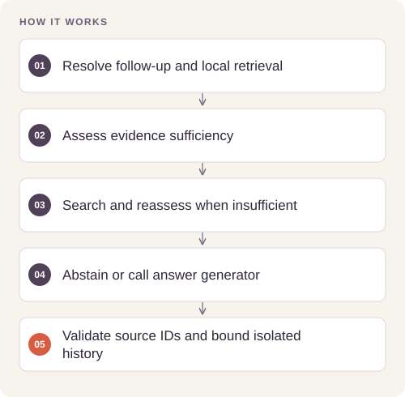

# Evidence-Grounded Research Agent

**Feras Elghandour** · Retrieval, evidence evaluation, and agent orchestration

Research answers need traceable sources and a clear response when the local knowledge base cannot support a claim. This project routes a question through local retrieval and an evidence-sufficiency check before using an external search provider.




## Reproduce and inspect

The executable reproduction profile now records exact commands, input/source hashes, dependency versions, logs and pass/fail status. Its scope distinguishes behavior checks from full-data benchmarks.

[Commands, artifacts and benchmark scope](BENCHMARKS.md) · [Versioned profiles](reproduction.json)


## Try a small example

Local deterministic callbacks exercise evidence assessment and bounded history. No external search provider or language model is called.

After the local setup below, run from the repository root:

```sh
python examples/quickstart.py
```

The [example source](examples/quickstart.py), [captured output](examples/expected-output.txt) and [execution record](examples/environment.json) keep this demonstration inspectable. Floating-point values may vary with library versions.

Observed output from this run:

```text
{'answer': 'Released in 2020.', 'citations': ('local:1',), 'trace': ('retrieve', 'assess')}
```

## Implementation

`research.py` contains a standalone, provider-neutral workflow. Inject retrieval, assessment, search, question-resolution, and answer-generation adapters. It validates confidence bounds, rechecks fallback evidence, rejects unknown citations, and retains a bounded history separately for each session. Evidence must be treated as data by every generation adapter.

## Evidence and results

The original implementation indexed 15 video-game records and recorded three research examples plus one follow-up. Its saved validation covered persistent retrieval, local evidence routing, live web fallback, structured citations, and session isolation. These are functional examples, not a held-out accuracy benchmark.

This portable edition replaces the original framework integration with explicit adapter interfaces. Six automated tests cover local routing, fallback reassessment, provider failure, citation rejection, bounded session memory, and confidence validation. They use synthetic fixtures and make no paid API calls. The original online examples have not been rerun against this edition.

## Reproduce

Python 3.11 or later; standard library only:

```sh
python -m unittest discover -s tests -v
```

Create a `ResearchAgent` with five callable adapters, then call `invoke(question, session)`. Adapters return `Evidence`, `Assessment`, and `Answer` values. No live model or search credentials are needed for tests. Configure credentials outside version control when adding live providers.

## Practical relevance and limits

The workflow is suitable for prototyping catalog research or internal knowledge assistants where an evidence gap must be visible. Citation membership does not prove that an answer follows from its sources. Confidence requires calibration; production use also needs authorization, durable session storage, prompt-injection evaluation, and operational monitoring. This repository contains the workflow core; it does not include a vector database, hosted application, supplied catalog, or provider SDK wrappers.
